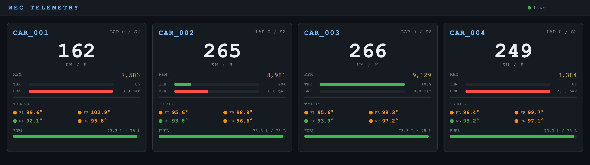
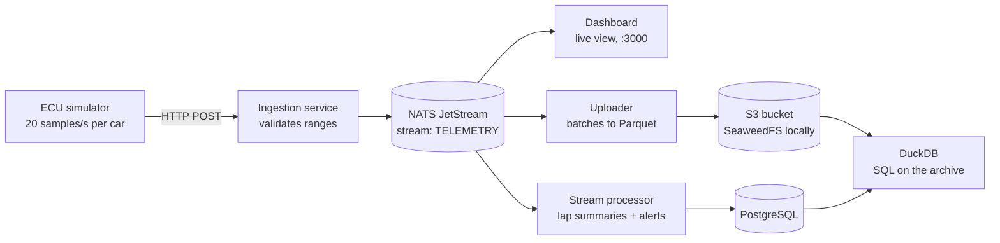

# WEC Telemetry Pipeline

A side project that simulates telemetry from endurance race cars (WEC / Le Mans style). It runs the data through a pipeline that a team could use on a race weekend:

- **On the pit wall:** race engineers see each car live.
- **During the race:** every lap is summarised, and warnings are raised when something runs too hot or fuel gets low.
- **After the race:** analysts can run SQL over every raw sample.

Everything runs on one machine with Docker Compose. The car data comes from a simulator, not a real car.



## Why it is built this way

At a race track the internet connection is often unreliable, but the engineers still need live numbers. Analysts back at the factory want all the data, but they don't need it the second it is recorded.

So the data first goes into a local message queue (NATS JetStream), which keeps it on disk. Each part of the system reads from that queue at its own pace:
- The dashboard only wants the newest values.
- The lap processor reads every sample once.
- The uploader copies everything to object storage, whenever storage is reachable. If the connection drops, nothing is lost: the uploader picks up where it stopped.

## How the data flows



| Part | What it does |
|---|---|
| [ECU simulator](services/ecu-simulator/) | Simulates N cars on Le Mans, Spa or Imola: speed, RPM, throttle, brakes, tyre and brake temperatures, fuel, pit stops. |
| [Ingestion service](services/ingestion-service/) | Receives each sample over HTTP, rejects out-of-range values, and publishes it to NATS. |
| NATS JetStream | Stores the stream on disk for 7 days. Each consumer keeps its own position in the stream. |
| [Dashboard](services/dashboard/) | Live view per car, refreshed 5 times a second over a WebSocket. |
| [Stream processor](services/stream-processor/) | Builds one summary row per completed lap (lap time, fuel used, top speed, tyre and brake temperatures, pit stop) and writes alerts for hot tyres, hot brakes and low fuel. |
| [Uploader](services/cloud-uploader/) | Every 10 seconds (or every 500 samples, whichever comes first), writes the new samples as Parquet files to S3, one folder per session and car. |
| [DuckDB](analytics/) | SQL over the Parquet archive, joined with the Postgres lap table when needed. |

## Running it

You need Docker. The first build takes a few minutes.

```bash
docker compose up --build -d
```

Then:

| What | Where |
|---|---|
| Live dashboard | http://localhost:3000 |
| Lap summaries | `make laps` |
| Alerts | `make alerts` |
| Raw files in the bucket | http://localhost:8888/buckets/wec-telemetry/ |
| SQL over the archive | `make query` (interactive) or `make query-examples` |

`make help` lists every command. Track, number of cars and pit stop interval are set on the `ecu-simulator` service in [docker-compose.yml](docker-compose.yml).

Ports 3000, 4222, 5432, 8080, 8222, 8333 and 8888 must be free on your machine.

## Querying the archive with DuckDB (instead of Athena)

The original plan was to store the raw data in AWS S3 and query it with Athena. Athena runs SQL directly on files in S3 without loading them into a database first. That needs an AWS account, so locally the project uses two stand-ins:

- **SeaweedFS** in place of AWS S3. It speaks the same S3 API, so the uploader code is the same either way. To use real S3, you would only change the endpoint and keys.
- **DuckDB** in place of Athena. Like Athena, it reads Parquet files straight from the bucket and understands the `session_id=…/car_id=…` folder layout, so you can filter on those columns.

The SQL is standard, so most queries would also run on Athena. A few things are specific to DuckDB, for example `PIVOT` and `epoch()`, and would need small changes there.

The example queries are in [analytics/queries](analytics/queries/), and `make query-examples` runs all of them. Below is real output from two of them, from a run with two cars at Imola and a pit stop every 3 laps.

Lap times rebuilt from the raw samples ([02_lap_times.sql](analytics/queries/02_lap_times.sql)). The longer lap 3 contains the 30-second pit stop:

```
┌─────────┬───────┬──────────────┬───────────────┬─────────────┬─────────┐
│ car_id  │  lap  │   lap_time   │ top_speed_kmh │ fuel_used_l │ pitted  │
│ varchar │ int32 │   interval   │    double     │   double    │ boolean │
├─────────┼───────┼──────────────┼───────────────┼─────────────┼─────────┤
│ CAR_001 │     0 │ 00:01:40.3   │         267.0 │        2.66 │ false   │
│ CAR_001 │     1 │ 00:01:36.849 │         267.0 │        2.55 │ false   │
│ CAR_001 │     2 │ 00:01:37.06  │         267.0 │        2.56 │ false   │
│ CAR_001 │     3 │ 00:02:10.947 │         265.0 │        2.67 │ true    │
│ CAR_002 │     0 │ 00:01:38.999 │         271.0 │        2.62 │ false   │
│ CAR_002 │     1 │ 00:01:35.601 │         271.0 │        2.52 │ false   │
│ CAR_002 │     2 │ 00:01:34.458 │         273.0 │         2.5 │ false   │
│ CAR_002 │     3 │ 00:02:08.851 │         273.0 │        2.62 │ true    │
└─────────┴───────┴──────────────┴───────────────┴─────────────┴─────────┘
```

Lap times computed live by the stream processor, compared against the same laps rebuilt from the archive ([05_raw_vs_stream_processor.sql](analytics/queries/05_raw_vs_stream_processor.sql)). The two paths read the same stream independently. If one of them lost or duplicated data, they would disagree. The ±1 ms differences come from the archive storing timestamps at millisecond precision:

```
┌─────────┬───────┬────────────┬────────────────┬─────────┐
│ car_id  │  lap  │ live_lap_s │ archived_lap_s │ diff_ms │
│ varchar │ int32 │   double   │     double     │  int32  │
├─────────┼───────┼────────────┼────────────────┼─────────┤
│ CAR_001 │     0 │      100.3 │          100.3 │       0 │
│ CAR_001 │     1 │      96.85 │          96.85 │       0 │
│ CAR_001 │     2 │      97.06 │          97.06 │       0 │
│ CAR_001 │     3 │     130.95 │         130.95 │      -1 │
│ CAR_002 │     0 │       99.0 │           99.0 │       0 │
│ CAR_002 │     1 │       95.6 │           95.6 │       1 │
│ CAR_002 │     2 │      94.46 │          94.46 │       0 │
│ CAR_002 │     3 │     128.85 │         128.85 │       0 │
└─────────┴───────┴────────────┴────────────────┴─────────┘
```

## Data

Each sample is one JSON object (20 per second per car):

```json
{
  "event_id": "3f6c…", "timestamp": "2026-06-14T15:02:11.250Z",
  "session_id": "SESSION_20260614_150000", "car_id": "CAR_001",
  "lap": 12, "sector": 1,
  "speed_kmh": 287.4, "rpm": 9120, "throttle_percent": 100, "brake_pressure_bar": 0,
  "tire_fl_temp": 98.5, "tire_fr_temp": 101.2, "tire_rl_temp": 96.0, "tire_rr_temp": 98.9,
  "brake_temp": 245.0, "fuel_level_liters": 41.3, "fuel_flow_lph": 148.0,
  "gps_lat": 47.9497, "gps_long": 0.2076, "on_track": true, "in_pit": false,
  "schema_version": "1.0"
}
```

In S3 the samples are stored as Parquet, zstd-compressed:

```
s3://wec-telemetry/session_id=SESSION_…/car_id=CAR_001/20260614T150211.250Z_9725.parquet
```

In Postgres there are two tables: `lap_metrics`, with one row per car per lap, and `alerts`, with at most one alert of each kind per car per lap.

## Design choices

- **NATS JetStream rather than Kafka.** It is a single small binary that runs fine on a laptop, keeps data on disk, and lets each consumer resume where it left off. Kafka would also work, but it is a lot more to run for one team's two or three cars. Cloud-only services like Kinesis were ruled out because the track side has to work offline.
- **Acknowledge only after saving.** The processor and the uploader acknowledge a message only after it has been written to Postgres or S3. If either service crashes, NATS sends the messages again.
- **Safe to receive twice.** Lap and alert inserts use `ON CONFLICT DO NOTHING`, and each S3 file name includes the stream position. A message that arrives twice doesn't create duplicate rows or overwrite files.
- **Parquet for the archive.** It is a column format, so a query that reads only `speed_kmh` doesn't touch the other columns. DuckDB, Athena, Spark and pandas can all read it.
- **Partial laps are skipped.** If the processor starts in the middle of a lap, it doesn't write that lap, because its numbers would be wrong.

## What is not done

- No REST API for lap history yet. For now, use `make laps` or query Postgres directly.
- No authentication anywhere. The credentials in the repo are local development values.
- Everything runs as a single node; nothing has been tested for failover.
- The car model is simplified. It produces believable numbers (Imola laps around 1:35, Le Mans around 3:33), but it is not a vehicle-dynamics model.
- No Athena, Glue or Terraform setup for real AWS.

## Tests

```bash
make test
```

The tests cover:
- the simulator physics: realistic lap times per track, values within the ingestion limits, pit stop timing
- the lap and alert logic in the stream processor
- writing and reading back a Parquet file in the uploader

## Layout

```
services/
  ecu-simulator/      car simulator (Go)
  ingestion-service/  HTTP → NATS (Go)
  stream-processor/   lap summaries and alerts → Postgres (Go)
  cloud-uploader/     NATS → Parquet on S3 (Go)
  dashboard/          live pit-wall page (Go + plain HTML/JS)
analytics/            DuckDB image, start-up script, example queries
infrastructure/       SeaweedFS S3 credentials for local use
docs/images/          screenshots
docker-compose.yml
Makefile
```
